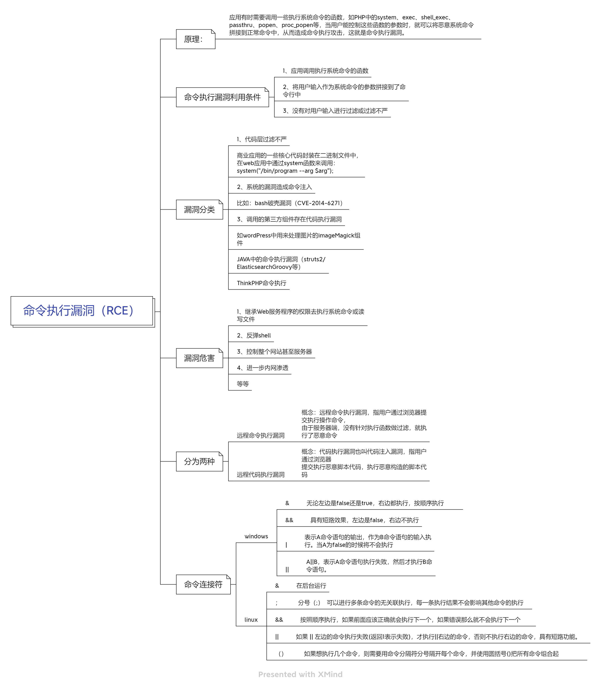

## 1.RCE-命令执行漏洞

> **RCE（Remote Code Execution，远程代码执行）** 描述远程执行代码的能力或结果；**操作系统命令注入**、**代码注入**等是可能造成该结果的不同机制。命令执行不限定通过浏览器触发，也不等于获得管理员权限。本节讨论命令执行与命令注入，第二节讨论代码求值和组件案例。

### 漏洞原理

应用调用外部程序或命令解释器时，如果不可信输入能够改变预期命令结构、选择任意可执行程序，或进入程序的危险参数，就可能产生执行风险。

常见的 **Shell 命令注入**是将用户输入拼接进命令字符串，交给 CMD、Bash／sh 等解释器处理，使输入中的特殊语法改变原有命令。**参数注入**与 Shell 元字符注入应区分：不经过 Shell 时，连接符未必被解释，但危险选项仍可能改变被调用程序的行为。

### 利用前提

1. 不可信输入能够到达外部程序、命令字符串或其他执行入口。
2. 输入能改变执行语义，而不是始终作为受约束的普通参数传递。
3. 输入校验、参数约束或执行接口的使用方式存在缺陷。
4. 若依赖连接符、命令替换或重定向，需要实际解释器支持对应语法。
5. 执行及其后续影响受进程身份、文件权限、网络访问和运行环境限制。

> 回显、延时、DNSlog 等是**验证渠道**，不是漏洞存在的必要条件。反弹 Shell、写文件还需要额外条件，不能列为每个漏洞都具备的前提。

### 漏洞分类

1. 不可信输入进入 Shell 命令字符串，形成命令注入。
2. 用户能够选择不应暴露的可执行程序，或控制其危险参数。
3. 中间件、组件漏洞或未授权管理接口可能暴露执行能力，但应分别判断根因，不能全部归为命令拼接过滤问题。

### 漏洞危害

1. 通常以应用或工作进程的身份执行操作；不一定等于前端 Web 服务器进程身份，更不必然拥有管理员权限。
2. 在权限允许时读取或修改文件、访问数据库和其他资源。
3. 具备相应条件时写入后门、建立远程会话或进一步访问内网。
4. 数据泄露、数据篡改或服务中断等影响，取决于执行身份和环境限制。

### 漏洞利用

#### 命令拼接符

> 按**实际解释器**区分语法，不能只按 Windows／Linux 区分。下表语法必须处于可被解释器识别的位置；若输入作为普通参数或被正确引用，不一定生效。

| 解释器 | 拼接符／语法 | 含义 | 示例 |
| --- | --- | --- | --- |
| Windows CMD | `&` | 前一条结束后执行下一条，不要求前一条成功 | `echo first & whoami` |
| CMD、Bash／sh | `&&` | 前一条成功后执行下一条 | `echo first && whoami` |
| CMD、Bash／sh | `\|` | 将前一程序的标准输出接到后一程序的标准输入 | CMD：`echo dir \| cmd`；Bash／sh：`printf 'hello\n' \| cat` |
| CMD、Bash／sh | `\|\|` | 前一条失败后执行下一条 | CMD：`cmd /c exit 1 \|\| whoami`；Bash／sh：`false \|\| whoami` |
| Bash／sh | `;` | 顺序执行，前一条结束后再执行下一条 | `printf 'first\n'; whoami` |
| Bash／sh | `&` | 异步执行前一条，Shell 可继续执行后续命令 | `printf 'first\n' & whoami` |
| Bash／sh | 反引号 | 命令替换，使用命令的标准输出，示例见下方 | 不等同于 PHP 字符串语法 |
| Bash／sh | `$()` | 命令替换，支持嵌套 | `echo "$(whoami)"` |

```bash
# Bash／sh 的反引号命令替换
echo `whoami`
```

> **版本与行为限制**：
>
> - Windows PowerShell 5.1 不支持 `&&`、`||`；PowerShell 7 才引入管道链运算符。PowerShell 的 `&` 也不能直接套用 CMD 的语义。
> - Linux 的 `ping` 默认持续发送，`ping 127.0.0.1; whoami` 会等待前一条结束；有限请求可按该系统使用 `ping -c 1`。Windows 次数参数则是 `-n`。
> - `||` 依据退出状态判断，不是看到“没有回显”就执行。管道也不代表后一个程序一定将输入文本当命令执行。

#### 命令执行接口（PHP）

| 接口 | 输出与返回值 | 限制 |
| --- | --- | --- |
| `system($command)` | 执行并输出结果；成功返回最后一行，失败可返回 false | 不是只返回、不输出 |
| `exec($command, $output, $result_code)` | 不自动输出；返回最后一行，可经第二个参数获取各行输出、第三个参数获取退出状态 | 不能理解为无法获取完整输出 |
| `shell_exec($command)` | 将标准输出作为字符串返回；错误或无输出时可能返回 null，管道建立失败可返回 false | 不能仅据空返回值判断执行是否成功 |
| PHP 反引号 | 执行命令并返回输出，作用类似 shell_exec | 与 Bash 的反引号属于不同语法层级 |
| `passthru($command, $result_code)` | 直接输出命令原始结果，可获取退出状态 | 不代表绕过权限 |
| `popen($command, $mode)` | 成功返回单向进程管道的流资源，失败返回 false | r 读取输出，w 写入输入；读用 fread 等，写用 fwrite，关闭用 pclose |

> 接口是否可用取决于 PHP 构建、配置和系统环境。标准错误与标准输出是不同通道；无回显不等于命令没有运行。API 名称本身也不表示存在漏洞，关键是不可信输入是否能改变执行语义。

### 绕过

> 以下保留旧练习写法，假设实验目录存在 `flag.php`。**字符串变形不保证绕过实际校验**；是否成立取决于过滤阶段、引用方式、解释器、工具及权限。

#### 1.黑名单相关写法

| 思路 | 原练习写法或修正示例 | 环境与限制 |
| --- | --- | --- |
| 变量拼接 | `a=ca;b=t;c=flag;$a$b $c.php` | Bash／常见 sh 的赋值和展开语法，不是 CMD 用法 |
| 编码后解释 | `echo "Y2F0IGZsYWcucGhw" \| base64 -d \| bash` | 原 scho 拼写错误；需要 base64 和 bash，解码参数依工具实现而异 |
| 引号拼接 | `ca""t fla''g.php` | Bash／sh 在未被外层引用限制时进行引号移除，不能照搬到所有解释器 |
| 反斜杠 | `ca\t fla\g.php` | Bash／sh 中未引用的反斜杠可引用后一个字符；单引号等上下文行为不同 |
| 路径通配符 | `cat flag.ph?` | 必须是半角 ?，匹配单个字符；读取哪些文件取决于目录内容及展开规则 |
| 特殊参数 | `ca$@t fl$@ag.php` | 依赖位置参数；没有位置参数时才可能按预期消去 $@，不是恒等替换 |
| PowerShell 路径匹配记录 | `powershell C:\*\*32\c??c.exe` | 保留原计算器练习；需核对命令路径匹配行为、匹配项和 calc.exe 是否存在，不标为必然等价于 calc |
| 使用其他工具 | 使用环境中可用的同类功能命令 | 工具、参数及返回结果都要核对，不能只替换名称就认定有效 |

#### 2.长度限制

原记录 `cat flag.php > a; sh a` **不能证明长度限制绕过**：

1. `>` 写入的是文件内容，不是字符串“cat flag.php”这条命令。
2. `sh a` 将内容作为 Shell 脚本解释，不会自动重新执行原读取命令。
3. 整段输入没有缩短。长度限制需明确校验位置、长度单位及能否跨请求保存状态等条件；现有记录未给出完整复现过程。

#### 3.空格限制

| 写法 | 核对说明 |
| --- | --- |
| `cat%0dflag.php` | %0d 为 CR（回车），需先发生相应解码；解码后也不保证被 Shell 当作空格。不是通用等价命令，也不限定只能通过浏览器提交 |
| `cat${IFS}flag.php` | 依赖 Bash／sh 的未引用展开和字段分割，IFS 取值影响结果；不是 Linux 操作系统独有，不适用于 CMD |
| `ping%CommonProgramFiles:~10,-18%127.0.0.1` | CMD 环境变量子串展开；仅在实际变量值和长度使切片得到空格时才符合示例意图，并非任意 Windows 都成立 |

### 无回显验证

1. **响应与时间观察**：能否读取结果、观察可重复的延时变化，取决于应用数据流和执行方式；应排除网络抖动等干扰。
2. **文件结果**：需要写权限；若通过 HTTP 访问结果，还需文件位于可访问位置。写出文本结果与执行写入的脚本是不同条件。
3. **出站交互**：DNSlog 等需要服务端能进行对应网络访问；DNS 标签的字符与长度限制也会影响结果。
4. **远程会话**：nc 等工具是否存在、参数版本、出站通信及进程管道条件均会影响结果，不是通用验证前提。

---

## 2.RCE-远程代码执行漏洞

> **代码注入**是将不可信内容作为程序代码求值的一类问题；**远程代码执行**还可能来自反序列化、表达式处理、组件实现缺陷等其他路径。PHP 字符串求值只是其中一组机制，不能概括所有 RCE。

### 漏洞原理

应用将用户可控内容交给 `eval`、旧版字符串求值接口，或进入其他动态执行路径时，输入可能从数据变成代码。需结合调用位置、可控范围、语法上下文、版本与配置判断风险。

### 利用前提

1. 不可信输入能够到达某个代码求值或执行路径。
2. 输入能够影响实际执行的代码或调用行为，未被约束为普通数据。
3. 对应语言、组件版本及运行配置支持该路径。
4. 后续读写文件、调用系统命令和访问网络分别受权限与环境限制，不要求全部具备。
5. 回显、延时、出站交互等用于验证，不是漏洞存在的必要条件。

### 漏洞分类

1. 将用户输入拼入待求值代码，造成代码注入。
2. 不受约束的动态调用，暴露不应由用户选择的功能。
3. 反序列化、表达式注入、模板注入、文件包含等在满足特定条件时造成代码执行；这些漏洞并非必然都能达到 RCE。
4. 第三方组件实现缺陷或未授权执行接口造成执行风险，需按各自根因分析。

### 漏洞利用

#### 危险求值与动态调用（PHP）

| 机制 | 正确说明 | 版本／配置限制 |
| --- | --- | --- |
| `eval($code)` | 语言构造，不是普通函数；将字符串作为 PHP 代码求值 | 正确配置名为 disable_functions；它不能直接禁用 eval，但内部调用其他函数仍受相应限制 |
| `assert($assertion)` | 旧版可对字符串断言求值，不能泛称“括号内输入都当代码执行” | 字符串求值在 PHP 7.2 弃用、8.0 移除；旧版还受 assert.active、PHP 7 的 zend.assertions 等设置影响 |
| `preg_replace` 的 `/e` | 旧版在发生匹配时对替换表达式求值，不是任意 preg_replace 都能执行代码 | /e 在 PHP 5.5 弃用、7.0 移除；5.5／5.6 仍存在，不能只标 PHP<5.5 |
| `create_function($args, $code)` | 根据字符串动态生成函数，内部使用 eval；拼写不是 create_fuction | PHP 4.0.1 起提供，7.2 弃用、8.0 移除；现代闭包与此接口不同 |
| 变量函数调用 | 将变量或表达式的值作为可调用对象，参数按被调用接口处理 | 不是任何字符串都会当代码；eval 等语言构造不能按普通变量函数调用 |

**旧版 `preg_replace /e` 示例**：

```php
// 仅适用于提供 /e 的旧版 PHP；$a 为替换表达式。
echo preg_replace('/test/e', $a, 'just test');
```

`$a` 是第二个参数；原“参数 s”与代码不一致。必须发生匹配并满足旧版求值条件，不能推广到 PHP 7/8。

**旧版 `create_function` 记录**：

```php
// 旧版不安全写法：请求数据被用作生成函数的代码。
$b = create_function('', $_REQUEST['a']);
```

通常生成的函数体要在调用返回的函数后执行；若输入破坏生成代码的语法边界，还可能在内部求值阶段产生额外执行。原 `a=}phpinfo();//` 是针对特定生成代码上下文的闭合练习，不对任意拼接位置都成立。正确关键字为 `function`，数组字符串键应写为 `'a'`。

**变量函数调用记录**：

```php
// 不安全示意：函数名和参数由外部输入决定。
$_GET[1]($_GET[2]);
```

原 `$__GET` 多了一个下划线。这是**动态调用**，不是“GET 传参嵌套”。例如函数名为 `strlen` 时，参数被作为字符串计算长度，不会再当作代码执行。原 `1=assert&2=phpinfo()` 只能作为旧版字符串断言记录，需同时核对版本、断言配置和实际调用路径。

#### 字符串插值与函数调用（PHP）

> **普通变量插值不会递归执行变量值中的代码文本，但特定插值表达式可以在求值时调用函数。** 双引号和 heredoc 支持插值；单引号和 nowdoc 不进行同样的变量插值。仅添加花括号不代表可以执行任意 PHP 语句。

| 双引号中的写法 | 行为 |
| --- | --- |
| `"demo()"` | 普通文本，不调用函数 |
| `"{demo()}"` | 普通文本，单纯加花括号仍不调用函数 |
| `"$value"`、`"{$value}"` | 插入变量值，不会再次将其内容作为插值源代码解析 |
| `"${demo()}"` | 调用 demo，再将返回值作为变量名查找；函数调用的副作用已发生 |
| `"{$fn()}"` | 调用变量函数，前提是 $fn 为有效的可调用对象 |
| `"{$obj->method()}"` | 调用对象方法 |
| `"{$arr[demo()]}"` | 计算数组下标时调用 demo |
| `"{${demo()}}"` | 复杂插值中的可变变量；调用 demo，再按返回值取变量 |

**无害对照示例**：

```php
function demo() {
    echo "[函数已调用]\n";
    return 'target';
}

$target = '取到了变量值';
$fn = 'demo';

echo "${demo()}\n";      // 调用 demo，再读取 $target。
echo "{$fn()}\n";        // 调用 demo，插入返回值 target。
echo "{${demo()}}\n";    // 调用 demo，再读取 $target。

$input = '${demo()}';
echo "$input\n";         // 原样输出 ${demo()}，不调用 demo。
echo "{$input}\n";       // 同样不再次解析变量内容。
```

- **验证范围**：以上无害调用与变量插值对照已在 PHP 7.3.4、8.2.29 本机验证；不能给所有历史写法统一标注“PHP>5.5”。
- PHP 8.2 起弃用字符串中的 `${var}`、`${expr}` 形式；8.2.29 中仍求值并产生弃用提示。普通 `{$value}` 和表中的 `{${demo()}}` 不属于同一项弃用。
- 原 `"${phpinfo()}"` **确实会调用 phpinfo**；返回值随后参与变量名解析，可能出现未定义变量提示。这与“输出变量就执行变量中的代码”不同。
- 只有当不可信输入进入待解析的 PHP 源代码／求值表达式，或可控的动态调用等执行路径时，才能进一步判断注入风险；普通插值本身不等于 RCE。

[PHP 字符串文档](https://www.php.net/manual/en/language.types.string.php)、[插值弃用 RFC](https://wiki.php.net/rfc/deprecate_dollar_brace_string_interpolation)。

#### CVE-2016-5734 phpMyAdmin 示例

[解析示例](https://github.com/vulhub/vulhub/blob/master/phpmyadmin/CVE-2016-5734/README.zh-cn.md)

**前提与版本**：

1. 能登录，并能使用表搜索替换功能及写入相应数据；只有账号密码不代表权限已满足。
2. 厂商列出的受影响分支为：4.0.x 中早于 4.0.10.16、4.4.x 中早于 4.4.15.7、4.6.x 中早于 4.6.3 的版本。
3. 还需结合 PHP 版本：厂商注明 PHP 5.4.6 及以后不允许相关正则参数的空字节截断，PHP 7 起移除 /e 求值，不能仅凭 phpMyAdmin 版本认定可复现。
4. Vulhub 链接采用 PHP 5.3 与 phpMyAdmin 4.4.15.6，不能推广为所有受影响分支均能使用同一方法。PHP 截断边界以厂商公告为准。

[厂商公告 PMASA-2016-27](https://www.phpmyadmin.net/security/PMASA-2016-27/)。

#### Struts2/s2-001 示例

> Struts2 是 Java Web MVC 框架。.action／.do 后缀只能作为线索，不能据此确认框架或漏洞，路径后缀可配置。

[解析示例](https://github.com/vulhub/vulhub/blob/master/struts2/s2-001/README.zh-cn.md)

- **版本**：Struts 2.0.0—2.0.8；厂商也列出特定 WebWork 版本及 altSyntax 条件。
- **触发条件**：特定表单验证失败后，用户提交值在重新显示时进入递归 OGNL 表达式处理。
- **历史修复边界**：Struts 2.0.9／XWork 2.0.4；用于理解本漏洞边界，不代表这些旧版本符合当前升级要求。

[Apache S2-001 公告](https://cwiki.apache.org/confluence/display/WW/S2-001)。

#### Struts2/s2-048 示例

[解析示例](https://github.com/vulhub/vulhub/blob/master/struts2/s2-048/README.zh-cn.md)

- **编号**：CVE-2017-9791。
- **条件**：Struts 2.3.x 使用 Struts 1 插件和 Struts 1 Action，并将不可信值直接拼进 ActionMessage 等受影响消息处理路径。
- Vulhub 采用 Struts 2.3.32 的 Showcase 应用；不能据此认定所有 Struts 2 应用或只匹配某个版本区间就必然存在该问题。
- 修复按公告使用资源键及参数化消息，避免直接拼接不可信消息文本。

[Apache S2-048 公告](https://cwiki.apache.org/confluence/display/WW/S2-048)。

#### ThinkPHP/5.0.23-rce

[解析示例](https://github.com/vulhub/vulhub/blob/master/thinkphp/5.0.23-rce/README.zh-cn.md)

- **机制**：请求方法处理缺陷，涉及 Request 类的方法调用与利用链。
- **靶场版本**：ThinkPHP 5.0.23 本身在演示范围内，不能将标题误读为“5.0.23 已修复”。
- 依赖具体路由和请求处理路径，与下一个控制器名处理案例不同，不能混用两组版本和前提。

#### ThinkPHP/5-rce

[解析示例](https://github.com/vulhub/vulhub/blob/master/thinkphp/5-rce/README.zh-cn.md)

- **机制与条件**：控制器名处理问题，链接说明涉及未开启强制路由的情形。
- 链接标题标注 5.0.22／5.1.29，演示环境采用 5.0.20；这些是案例版本信息，不能概括为所有 ThinkPHP 5.x 都适用。
- 实际环境需同时核对分支、补丁和路由配置。

#### 旧版向日葵 RCE

[工具项目地址](https://github.com/Mr-xn/sunlogin_rce)

[工具附件](assets/28.RCE漏洞/file-20261030215329544.zip)

- 项目作者注明测试客户端为 **11.0.0.33162**。
- 项目另列反馈版本 11.1.1、10.3.0.27372，应与作者实测版本区分，不能推出所有旧版均受影响。
- 需核对客户端平台、实际版本、相关本地服务／端口及可达条件；本笔记保留工具入口，不将其视为完整复现记录。

#### CMS DouPHP

[本地靶场附件](assets/28.RCE漏洞/file-20261030215445504.zip)

原练习记录的方向是**安装配置过程中生成／写入配置文件**，需追踪输入如何进入生成的 PHP 文件，以及该文件何时被加载执行。

> **待补充条件**：软件版本、安装器是否可访问、安装锁状态、可控参数、写入位置及实际执行路径。现有记录不足以确认漏洞编号及完整影响范围，不推广为“任意 DouPHP 配置写入都能 RCE”。



### 核对资料

- [CWE-78：操作系统命令注入](https://cwe.mitre.org/data/definitions/78.html)、[CWE-94：代码注入](https://cwe.mitre.org/data/definitions/94.html) —— 区分执行结果与形成机制。
- [PHP system](https://www.php.net/manual/en/function.system.php)、[exec](https://www.php.net/manual/en/function.exec.php)、[shell_exec](https://www.php.net/manual/en/function.shell-exec.php)、[popen](https://www.php.net/manual/en/function.popen.php) —— 输出、返回值及进程管道。
- [PHP assert](https://www.php.net/manual/en/function.assert.php)、[PHP 7 移除功能 RFC](https://wiki.php.net/rfc/remove_deprecated_functionality_in_php7)、[create_function](https://www.php.net/manual/en/function.create-function.php) —— 旧版求值接口的弃用／移除边界。
- [Bash 字段分割](https://www.gnu.org/s/bash/manual/html_node/Word-Splitting.html)、[PowerShell 管道链运算符](https://learn.microsoft.com/en-us/powershell/module/microsoft.powershell.core/about/about_pipeline_chain_operators) —— 解释器差异。

## 3.相关笔记

- [MOC-渗透测试](./MOC.md) —— 返回方向索引，查看学习路线与主题分组。
- [03.快速搭建渗透测试环境](./03.快速搭建渗透测试环境.md) —— 前置：理解实验网站与服务的搭建过程。
- [04.渗透常见的DOS命令](./04.渗透常见的DOS命令.md) —— 前置：查阅 Windows 常用命令。
- [05.Linux基础操作与配置](./05.Linux基础操作与配置.md) —— 前置：查阅 Linux 常用命令与文件操作。
- [06.Linux用户权限管理](./06.Linux用户权限管理.md) —— 前置：理解执行进程与文件权限。
- [13.信息收集](./13.信息收集.md) —— 前置：通过框架与组件识别定位相关案例。
- [15.PHP基础](./15.PHP基础.md) —— 前置：理解 PHP 函数与动态调用相关语法。
- [19.SQL注入利用方式](./19.SQL注入利用方式.md) —— 对照：比较 SQL 盲注与命令执行中的无回显验证思路。
- [24.文件上传漏洞](./24.文件上传漏洞.md) —— 关联：对照文件上传中的解析方式与执行权限。
- [25.文件包含漏洞](./25.文件包含漏洞.md) —— 关联：对照文件包含中的入口与运行条件。
